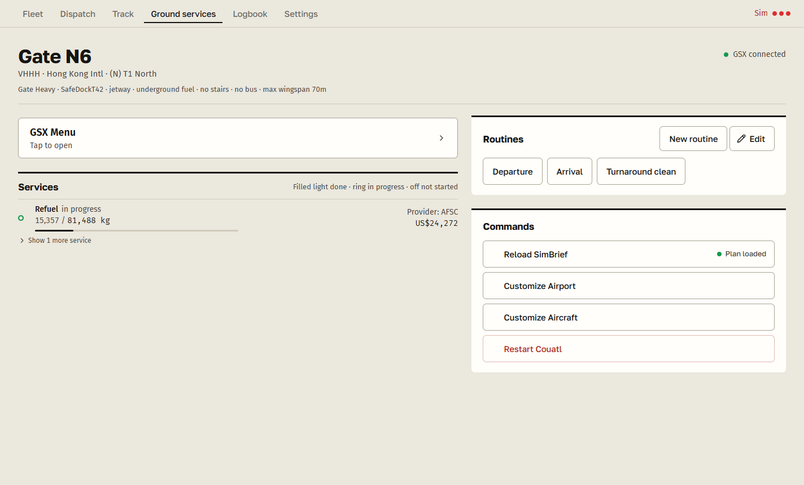

# GSX

WingLog works with GSX Pro by FSDreamTeam in two separate ways. Each has its own switch in
**Settings → 3rd party**.

> GSX Pro is a separate product by FSDreamTeam. WingLog isn't affiliated with them.

## Ground-service receipts

GSX Pro writes a receipt for each service it provides (catering, fuel, handling, passenger buses).
With **GSX ground services** on, WingLog attaches them to the matching flight in your Logbook, under
**Ground services**, with a total in the currency you choose.

- WingLog looks in GSX's usual receipts folder (`%APPDATA%\Virtuali\GSX\Receipts`). Use **Browse…**
  if yours is somewhere else.
- **Display currency** converts each receipt and the total, at the exchange rate for the day each
  receipt was issued. The local amount GSX charged is shown alongside.
- A receipt that doesn't say which aircraft it was for isn't attached automatically. The flight
  shows it as a possible match with an **Attach** button.
- **Rescan** looks again, for example after turning this on for flights you've already flown.

## GSX Remote Control

GSX Pro has a remote-control connection meant for other apps to use. With **GSX Remote Control** on,
WingLog's **Ground services** page runs GSX's menu without the in-sim window:

- **GSX Menu**: tap to open GSX's menu, then pick entries just as you would in the sim. Menus that
  need an answer straight away (pushback direction, fuel amount) also pop up over whatever page
  you're on.
- **Commands**: Customize Airport, Customize Aircraft, Restart Couatl, and reloading your SimBrief
  plan into GSX.
- **Services**: each service's progress (boarding, refuelling and so on), with what it's waiting for
  and its cost.
- The gate you're at is shown at the top.

The port is GSX's own default, 8744. If it doesn't connect, check **Remote Client** in GSX's own
settings.

### Routines

A routine asks GSX for several services with one button. On the **Ground services** page, above GSX's
menu, tap a routine's name to start it. Three come with WingLog:

- **Fenix-style departure**: Refueling and Catering together, then Boarding once Catering has
  finished, the way the Fenix A320's own EFB does it.
- **Arrival**: the jetway and GPU, then Deboarding.
- **Turnaround clean**: Deboarding, then Cleaning, Lavatory and Water.

While a routine runs, the page shows which stage it's in, where each service is, and what it's
waiting for. **Cancel** stops it. WingLog asks GSX for one service at a time, opening GSX's menu and
picking the service by its name, so it still works if GSX's menu changes while a service runs.

- **Questions GSX asks.** Which handling or catering operator to use is yours to answer, unless the
  routine is set to **Answer GSX's own default for me**. The refuelling level is yours unless the
  routine is set to **SimBrief block fuel**. Anything else, such as whether to attach the pushback
  tug, is always yours: the status line says **Waiting for you** and names the menu.
- **Fuel and passengers.** On some aircraft, such as the PMDG 777, GSX types the fuel and the payload
  into the aircraft's own computer, and two entries at once can mix up. A routine never asks for
  Boarding while the fuel is being entered, or for Refueling while the payload is.
- **Boarding needs a plan.** The flight needs a planned weight from SimBrief, and GSX needs your plan
  loaded (use **Reload SimBrief**). Without them the routine stops and says so.
- **A service GSX doesn't offer** at this stand is skipped, with the reason, and the routine carries
  on.
- **It stops by itself** if GSX disconnects, the aircraft moves, or pushback is requested. It doesn't
  carry on after WingLog restarts.

**New routine** makes your own: name it, tick the services, and WingLog lays them out in a sensible
order, which you can change by moving a service to another stage or choosing what a stage waits for.
The three that come with WingLog can't be changed; **Duplicate** makes a copy you can. Pushback and
de-icing aren't part of routines. On a phone or tablet you can start and cancel a routine but not
edit one.

### Finding your arrival gate

When you search GSX for a gate after landing, the gate search offers the gate BeyondATC assigned
you (with BeyondATC on), for example **Stand 102 (from ATC)**. It's there as soon as BeyondATC
assigns it, often before ATC says it. Click it to type it into GSX's search. Nothing is sent to GSX
until you click.
