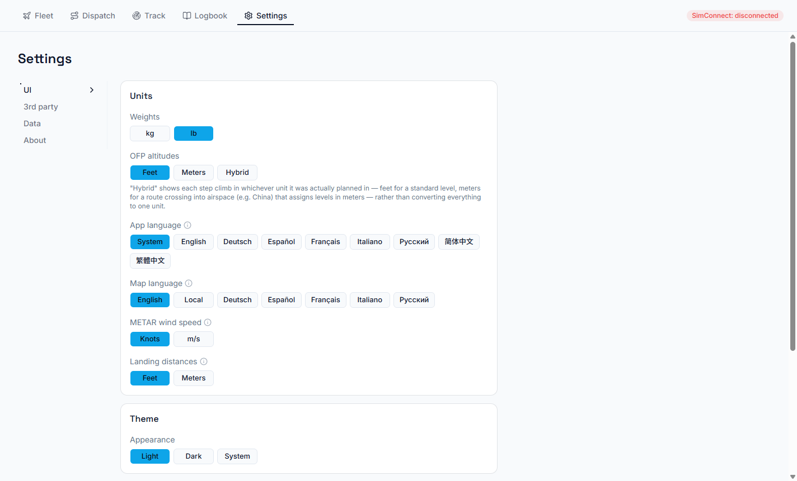
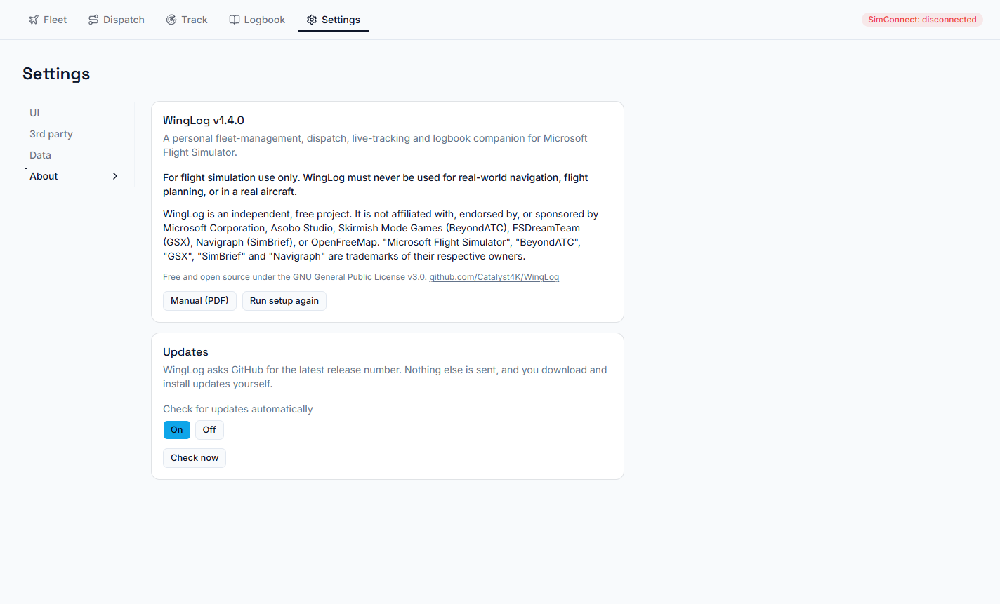

# Settings

Settings has four sections down the left.

## UI

| Setting | What it does |
|---|---|
| **Weights** | kg or lb. |
| **OFP altitudes** | Feet, metres, or **Hybrid**: each step climb in the unit it was planned in, feet for standard levels and metres where a route crosses airspace that assigns levels in metres (China, for example). |
| **App language** | English, Deutsch, Español, Français, Italiano, Русский, 简体中文, 繁體中文, or **System** to follow Windows. Aviation terms (ILS, SID, STAR, FL, QNH, ICAO codes) and anything from SimBrief stay in English. |
| **Map language** | The language of place names on the map. |
| **METAR wind speed** | Knots or m/s. |
| **Landing distances** | Feet or metres. |
| **Theme** | Light, dark, or follow Windows. |
| **Window: When I minimise the window** | **Taskbar** (the default) or **System tray**. In the tray WingLog takes no taskbar space and carries on tracking and serving the second screen; click the tray icon to bring the window back. Closing the window always closes WingLog, but while a flight is being tracked it asks first: the flight is kept, and you can resume or discard it when you open WingLog again. |
| **Tracking: Start tracking automatically** | On: WingLog starts tracking when the aircraft settles at the departure. Off: press **Start tracking** on Track (Dispatch's **Fly** still sets the flight up). |
| **Tracking: Finish flights automatically** | On: the flight is saved once you're parked with the engines off after landing. Off: press **Finish & save**. |

## 3rd party

- **SimBrief**: your username, and **Log in with Navigraph** for generating plans from WingLog.
- **GSX ground services**: on/off, receipts folder, display currency (see [GSX](08-gsx.md)).
- **GSX Remote Control**: on/off, host and port.
- **BeyondATC**: on/off and host (see [BeyondATC](07-beyondatc.md)).
- **Online network**: VATSIM, IVAO or None (None hides every VATSIM and IVAO feature) and your member
  number, keeping BeyondATC while online, whether the map offers the sim traffic button, and whether the
  ATC areas keep themselves up to date from GitHub, with the releases in use and **Check now** (see
  [Online networks](10-online-networks.md)).
- **Navigation data**: which navigation data your sim has. With Navigraph it shows the AIRAC cycle,
  its revision and how long it is valid, and warns when it is behind the current cycle. With the
  sim's own data it says WingLog cannot read the cycle and goes by the AIRAC calendar. WingLog keeps
  what it reads from the sim for each airport, and reads it again when you update the sim's data, so
  install the new cycle in the Navigraph Hub first and then open your airports in WingLog.

## Data

Import or export your **Fleet** and **Logbook** as CSV or JSON. Choose the file format first.

- Fleet import skips registrations you already have.
- A logbook export is a summary of each flight and its landing, not a full backup (no route or OFP).
  For a full backup, copy the database (see [Installing and updating](02-installing.md)).

- **Second screen**: on/off and port, and a button that shows a QR code and pairing code for a phone or tablet. Lists the devices that have paired, each with **Revoke** (see [Second screen](09-second-screen.md)).

## About

- WingLog's version, the simulation-only and not-affiliated notices, and the licence.
- **Run setup again** reopens the first-launch setup.
- **Updates**: whether WingLog checks for new versions automatically, **Check now**, the result
  of the last check, and **Download and install** when there is a newer version.

